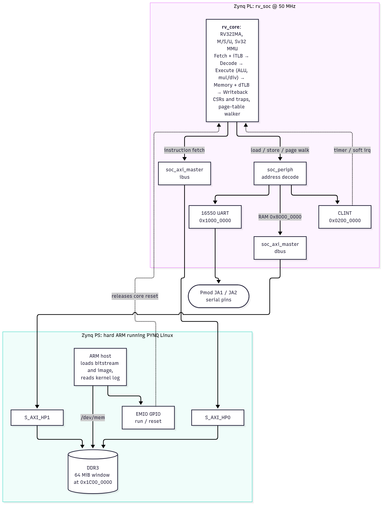
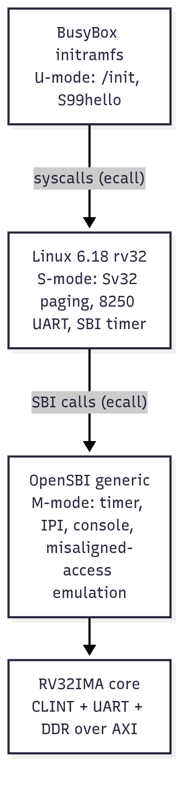

*[Full-quality video (mp4)](assets/rv32-linux-demo.mp4)*

# rv32-linux

A small, readable **RV32IMA** RISC-V core in SystemVerilog that boots **Linux 6.18** to userspace
on a real **PYNQ-Z2** (Zynq-7020) FPGA board.

- 5-stage in-order pipeline, `RV32IMA_Zicsr_Zifencei`, M/S/U privilege, **Sv32 MMU** (TLBs and a hardware page-table walker)
- ~1,800 lines of RTL for the core; 4.7k LUT, 5.0k FF, 0 BRAM, 4 DSP for the whole SoC at 50 MHz
- Verified in Verilator against the official [`riscv-tests`](https://github.com/riscv-software-src/riscv-tests): **139 / 139** passing, with and without random memory latency
- Runs OpenSBI, then a mainline Linux kernel with a Buildroot (musl, BusyBox) initramfs

## Status

| Milestone | State |
|---|---|
| RV32I 5-stage pipeline, Verilator bench, `rv32ui` | done |
| M (mul/div) and A (LR/SC, AMO) | done, `rv32um`, `rv32ua` pass |
| Zicsr, traps, M/S/U, delegation, timer/soft interrupts | done, `rv32mi`, `rv32si` pass |
| Sv32 MMU (TLBs + hardware walker), `sfence.vma` | done, all `-v-` (virtual memory) variants pass |
| OpenSBI (`generic`, rv32) boots an S-mode payload | done: SBI calls, delegated timer irq, paging, page faults |
| FPGA SoC: AXI bridges, UART, Vivado bitstream for PYNQ-Z2 | done, 50 MHz, timing met, runs on the board |
| OpenSBI + S-mode payload on the PYNQ-Z2 | done, same final PC as simulation |
| Buildroot (musl, BusyBox initramfs) + Linux 6.18 on the PYNQ-Z2 | done: reaches `/init` and runs scripts (~6 min boot, uncached DDR) |

`make test` runs 139 ISA tests plus the custom regressions in `sw/tests` and the OpenSBI boot.
Three upstream tests are skipped on purpose: `ma_data` (hardware misaligned access; OpenSBI
emulates it instead) and `breakpoint` (debug triggers).

## Architecture

The ARM side of the Zynq is the host: it loads the bitstream, writes the firmware into reserved
DDR and releases the core's reset. The core fetches and loads through its own AXI masters into
that same DDR, so there is no disk, network or soft DRAM controller.

Pipeline, bus protocol and MMU details are in [`docs/DESIGN.md`](docs/DESIGN.md). Diagram sources
are Mermaid (`docs/diagrams/*.mmd`); regenerate with
`npx @mermaid-js/mermaid-cli -i docs/diagrams/architecture.mmd -o docs/diagrams/architecture.png -b white -s 2`.

## Repository layout

| Path | Contents |
|---|---|
| `rtl/core/` | The core: `rv_core` (pipeline), `rv_fetch`, `rv_decode`, `rv_csr`, `rv_tlb`, `rv_ptw`, `rv_muldiv`, `rv_dmux`, `rv_alu`, `rv_regfile`, `rv_pkg` |
| `rtl/soc/` | FPGA SoC: AXI3 bridges, 16550 UART, CLINT, `rv_soc` top |
| `tb/` | Verilator testbenches: dual-port RAM, AXI RAM, CLINT, UART |
| `sw/` | Test runners, S-mode payload, device trees, OpenSBI build and patch |
| `sw/linux/` | Buildroot defconfig, kernel fragment, initramfs overlay |
| `fpga/pynq_z2/` | Vivado build and on-board runner ([bring-up guide](fpga/pynq_z2/README.md)) |
| `docs/` | Design notes and diagrams |

## Quick start (simulation)

Requires Verilator (tested with 5.052), a C++ compiler, `dtc`, `curl`, `git` and Python 3.

    sw/setup_tools.sh        # RISC-V GCC, riscv-tests, OpenSBI into tools/ (gitignored)
    make test                # lint-clean build + riscv-tests ISA suite
    sw/build_opensbi.sh      # payload + DTB + OpenSBI -> build/fw_payload.hex
    make test-custom         # regressions + OpenSBI boot
    make test-lat            # everything again with random extra memory latency
    make test-soc            # OpenSBI boot on the FPGA SoC (AXI + serial UART) in Verilator

To run something by hand:

    build/sim/Vtb_top +hex=build/fw_payload.hex +halt=<pc> +maxcycles=60000000 [+trace]

## Linux on the board

    sw/build_linux.sh        # Buildroot: musl toolchain + kernel with embedded initramfs (~4 GB disk)
    sw/build_linux_fw.sh     # kernel + DTB + OpenSBI -> build/fw_linux.bin

Then follow [`fpga/pynq_z2/README.md`](fpga/pynq_z2/README.md) and pass `--log 420` to
`run_on_board.py` to read the kernel log out of DDR when no serial adapter is attached.

Build notes: on an NTFS checkout Buildroot's `host-kmod` cannot extract (filenames containing
`:`), and GCC 16 needs `ac_cv_func_posix_spawn_file_actions_addchdir=yes` exported for `host-m4`.

## PYNQ-Z2 design

The DDR3 is wired to the ARM PS, not the fabric, so there is no soft DRAM controller:

    RV32 core (PL) --AXI--> Zynq PS7 S_AXI_HP0/HP1 --> DDR3
    ARM (PYNQ Linux) loads OpenSBI + kernel + initramfs into a reserved DDR window,
    then releases the RV32 core's reset through an EMIO GPIO line.

Console: a 16550 UART in the fabric on Pmod JA pins, or the kernel log read out of DDR by the ARM.
Both core buses use a small req/rsp protocol (see `docs/DESIGN.md`) that bridges to AXI.

## License and credits

MIT, see [LICENSE](LICENSE). Demo video includes a clip courtesy of Paramount Pictures.
