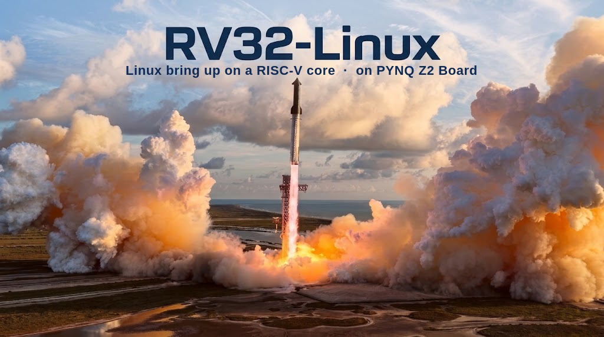
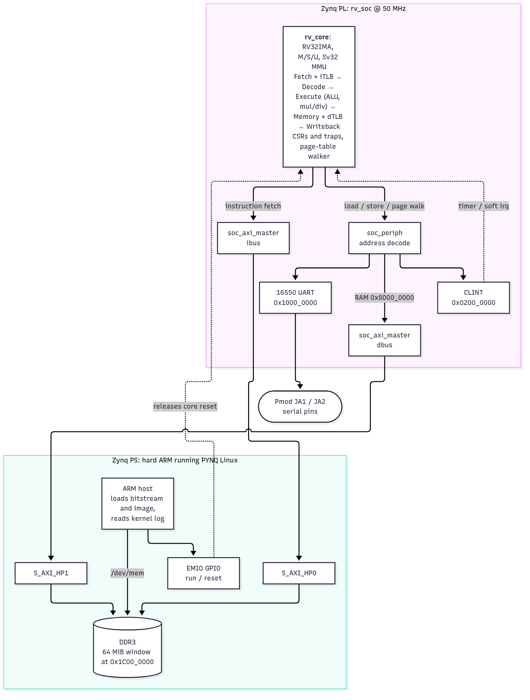
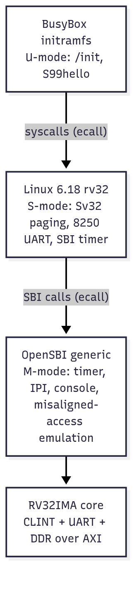

# rv32-linux: a readable Linux-capable RV32IMA core (SystemVerilog)

An in-order, 5-stage **RV32IMA_Zicsr_Zifencei** core with **M/S/U privilege** and an
**Sv32 MMU**, written to be small and readable, targeting a PYNQ-Z2 (Zynq-7020) and
mainline Linux. Verified in Verilator against the official `riscv-tests`, and **boots
Linux 6.18 to userspace on a real PYNQ-Z2** at 50 MHz (OpenSBI, Sv32, BusyBox initramfs).

## Status

| Milestone | State |
|---|---|
| RV32I 5-stage pipeline, Verilator bench, `rv32ui` | done |
| M (mul/div) and A (LR/SC, AMO) | done, `rv32um`, `rv32ua` pass |
| Zicsr, traps, M/S/U, delegation, timer/soft interrupts | done, `rv32mi`, `rv32si` pass |
| Sv32 MMU (TLBs + hardware walker), `sfence.vma` | done, all `-v-` (virtual memory) variants pass |
| OpenSBI (`generic`, rv32) boots an S-mode payload | done: SBI calls, delegated timer irq, paging, page faults |
| Spike lock-step co-sim | next |
| FPGA SoC: AXI bridges, serial UART, Vivado bitstream for PYNQ-Z2 (50 MHz, timing met) | done, runs on the board |
| OpenSBI + S-mode payload on the PYNQ-Z2 | done, same final PC as simulation |
| Buildroot (musl, BusyBox initramfs) + Linux 6.18 on the PYNQ-Z2 | done: reaches `/init` and runs scripts (~6 min boot, uncached DDR) |
| Interactive shell | needs a serial adapter on Pmod JA (the UART pins are untested) |
| Caches, timer-rate check (a 10 s `sleep` advances uptime ~3.4 s) | open |

`make test` result: **139 / 139** ISA tests (zero and random memory latency) plus the custom
regressions in `sw/tests` and the OpenSBI boot. Three upstream tests are skipped on purpose:
`ma_data` (hardware misaligned access; OpenSBI emulates it instead) and `breakpoint` (debug
triggers).

## Architecture

The ARM side of the Zynq is the host: it loads the bitstream, writes the firmware into reserved
DDR and releases the core's reset. The core fetches and loads through its own AXI masters into
that same DDR, so there is no disk, network or soft DRAM controller.

Diagram sources are Mermaid (`docs/diagrams/*.mmd`); regenerate with
`npx @mermaid-js/mermaid-cli -i docs/diagrams/architecture.mmd -o docs/diagrams/architecture.png -b white -s 2`.

## Layout

    rtl/core/    rv_core (pipeline), rv_fetch, rv_decode, rv_csr, rv_tlb, rv_ptw,
                 rv_muldiv, rv_dmux, rv_alu, rv_regfile, rv_pkg
    tb/          Verilator SoC: dual-port RAM, CLINT, 16550-style UART, testbench
    sw/          payload (S-mode test), DTS, test runners, OpenSBI build, patches
    docs/        design notes
    rtl/soc/     FPGA SoC: AXI3 bridges, 16550 UART, CLINT, rv_soc top
    fpga/        PYNQ-Z2 Vivado build (see fpga/pynq_z2/README.md)
    sw/linux/    Buildroot defconfig, kernel fragment, initramfs overlay

## Quick start

    sw/setup_tools.sh        # RISC-V GCC, riscv-tests, OpenSBI into tools/ (gitignored)
    make test                # lint-clean build + riscv-tests ISA suite
    sw/build_opensbi.sh      # payload + DTB + OpenSBI -> build/fw_payload.hex
    make test-custom         # regressions + OpenSBI boot
    make test-lat            # everything again with random extra memory latency
    make test-soc            # OpenSBI boot on the FPGA SoC (AXI + serial UART) in Verilator

Run something by hand:

    build/sim/Vtb_top +hex=build/fw_payload.hex +halt=<pc> +maxcycles=60000000 [+trace]

Requires Verilator (tested 5.052), a C++ compiler, `dtc`, `curl`, `git`, Python 3.

## Linux on the board

    sw/build_linux_fw.sh     # after the Buildroot build below: kernel + DTB + OpenSBI -> build/fw_linux.bin

    make -C tools/buildroot O=$PWD/build/linux BR2_DEFCONFIG=$PWD/sw/linux/rv32core_defconfig defconfig
    make -C build/linux      # musl toolchain, kernel with embedded initramfs (needs ~4 GB disk)

Then follow `fpga/pynq_z2/README.md` and pass `--log 420` to `run_on_board.py` to read the kernel
log out of DDR when no serial adapter is attached. Note: on an NTFS checkout `host-kmod` cannot
extract (filenames with `:`) and GCC 16 needs `ac_cv_func_posix_spawn_file_actions_addchdir=yes`
exported for `host-m4`.

## PYNQ-Z2 design

The DDR3 is wired to the ARM PS, not the fabric, so there is no soft DRAM controller:

    RV32 core (PL) --AXI4--> Zynq PS7 S_AXI_HP0 --> DDR3
    ARM (PYNQ Linux) loads OpenSBI + kernel + initramfs into a reserved DDR window,
    then releases the RV32 core's reset through an AXI-GPIO register.

Console: a UART in the fabric on Pmod/Arduino pins, or a shared-memory ring read by the ARM.
Both core buses use a small req/rsp protocol (see `docs/DESIGN.md`) that bridges to AXI.
